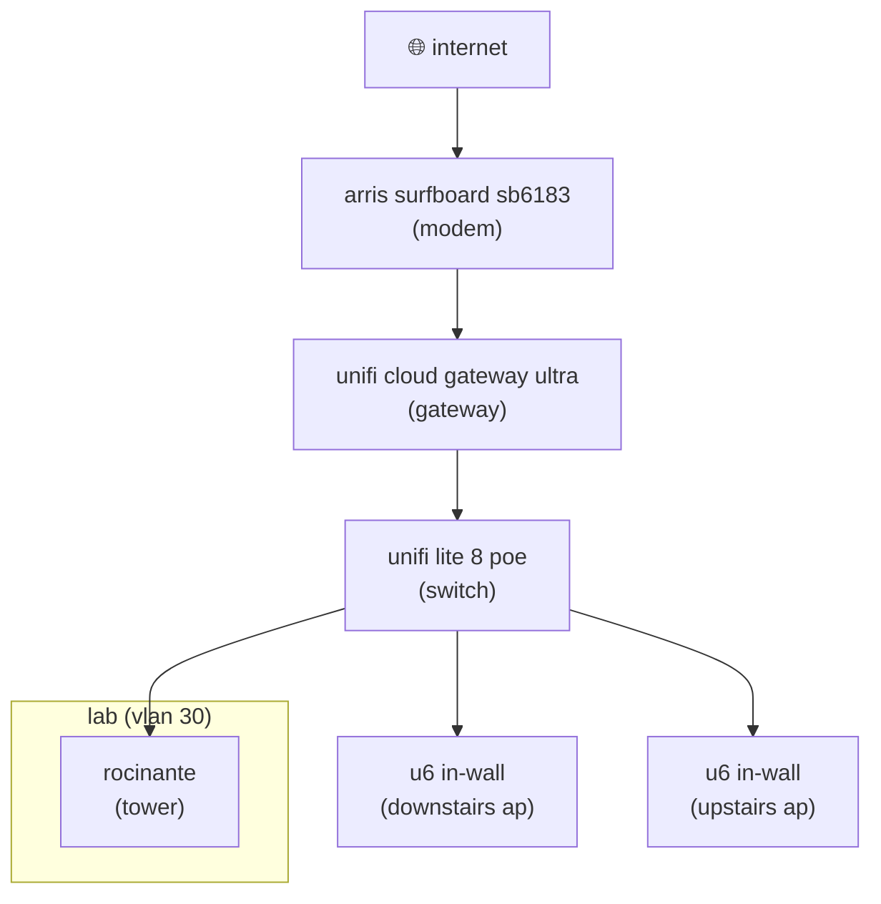
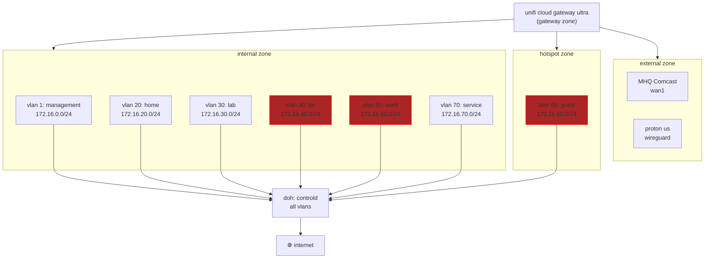

# homelab

hey there 👋🏻 this is my home lab. there are many like it, but this one is mine.

[peace be the journey](https://youtu.be/fu_6DXHut-Y?si=fUSLJ6zVKgsiiDO_) 🥂

* [overview](#overview)
* [network](#network)
* [hosts](#hosts)

## overview

homelab is here to support a few key items:

1. 🧪 **experimentation & learning**: i love tinkering - especially
with networking, platform services, and distributed systems; deployed and
managed securely with automation at every step.

1. 🏠 **service enablement**: my ultimate goal is to remove any dependency on
faang at both hardware and software levels. i want freedom, privacy,
control over our digital footprint - all while staying within the realm of
legit, sustainable tech.

1. 🏗️ **enterprise simulation**: ever tried homemade chicken wings after going
to [fire on the mountain](https://www.portlandwings.com/)? it's "okay" - sure -
but it is absolutely not the same. this setup lets me practice enterprise-style
patterns at home that would otherwise be atypical in a home environment.

anywho. it's a mix of learning, building useful stuff, practicing for the real
world, and reclaiming digital independence - all while keeping it fun
(🤞🏼).

---

---

## network

network & identity principles are quickly becoming the core fabric of securing software systems in the age of LLMs.

the homelab network is designed such that i am safe to experiment with meaningful architectures, securing the heck outta my own personal home network - all without sacrificing the niceties our family has grown to enjoy.

the network is the unsung hero and backbone of the homelab. it does not use its grade or position to attain pleasure, profit, or personal safety.

---

### design decisions

* 🛡️ **default-deny:** each network is entirely isolated as a means of reducing potentially impacted networks and enforcing (documented) least-privilege access.

* 🌐 **encrypted, split-horizon dns:** distinct internal vs external resolution allows for friendly private names like `gateway.morethq.com` to resolve on trusted devices within the network, without exposing them to the internet. public services resolve via [controld](https://controld.com/) using dns-over-https (doh).

* 🕵️‍♂️ **vpn protected egress:** traffic leaving the home routes through
proton vpn, with an exception route policy by device or network only as needed.

* 🏗️ **practical at-scale patterns at home:** over-segmentation, strict fire-walling, and comprehensive tls coverage give me a (relatively) safe and realistic playground to sniff paint and eat glue without risking vital data & services.

---

### hardware

* modem: arris - surfboard sb6183
* gateway: unifi cloud gateway ultra
* switch: unifi lite 8 poe
* access points:
    * (2) unifi u6 in-wall

    
network infrastructure diagram

---

### segmentation

the network is segmented into 4 high-level trust zones, with a default-deny route policy across networks.

there are 7 vlans, each with their own subnet and scope.

zones:

| zone     | members                     | description                        |
| -------- | --------------------------- | ---------------------------------- |
| internal | vlans 1, 20, 30, 40, 50, 70 | internal networks                  |
| external | MHQ Comcast (wan1), proton  | the internet uplink and vpn client |
| gateway  | gateway                     | gateway; enforces firewall rules   |
| hotspot  | vlan 60                     | guest wi-fi; internet-only access  |

vlans:

| vlan | purpose    | subnet         | notes                                  |
| ---- | ---------- | -------------- | -------------------------------------- |
| 1    | management | 172.16.0.0/24  | gateway, aps                           |
| 20   | home       | 172.16.20.0/24 | personal devices                       |
| 30   | lab        | 172.16.30.0/24 | experimental services, containers      |
| 40   | iot        | 172.16.40.0/24 | smart devices, internet-only, isolated |
| 50   | work       | 172.16.50.0/24 | work device, internet-only, isolated   |
| 60   | guest      | 172.16.60.0/24 | guest wifi, internet-only, isolated    |
| 70   | service    | 172.16.70.0/24 | internal production apps, media, sync  |

* all egress traffic goes through proton over wireguard, except management (vlan 1) and work (vlan 50). if/when the tunnel drops, traffic halts (kill switch) instead of egressing via the wan.
* all dns queries go through controld via doh.
* vpn client dns is routed via the gateway (`172.16.0.1`). unifi forces dns for routed clients to the wireguard conf's dns value, instead of through the encrypted dns (controld) set via CyberSecure.
* vlans 40 (iot), 50 (work), and 60 (guest) are strictly internet-only and are entirely isolated from any internal networks.
* vlans 1 (mgmt), 20 (home), 30 (lab), and 70 (service) have internal routing
as needed.

    
network segmentation diagram

---

### wired hosts

[rocinante](hosts/rocinante/README.md) connects directly to the switch on **port 8**. the traffic on this port is explicitly designated as vlan 30 (lab).

---

## hosts

a host is a physical machine with a name.

| host | hardware | what it is for |
| --- | --- | --- |
| [rocinante](hosts/rocinante/README.md) | tower. ryzen 9 5900x, rtx 4070 super, 32G | gaming and development |
| [sector7](hosts/sector7/README.md) | nuc. gmktec nucbox g10 pro, ryzen 5 3500u | devbox, and a small k3s cluster |

both run arch linux. rocinante is the only device with a desktop, all others are headless and can only be reached over ssh from a vault-secured, hardware auth protected, and agent forwarded ssh key.

### names

rocinante, or roci, is the name of Don Quixote's horse. why is this meaningful to me? it's also the name of the ship crewed by a fantastic set of characters in the expanse book and tv series.

sector7 (sector 7) is the name of one of the 8 sectors of midgar in the final fantasy 7 stories. why is this meaningful to me? final fantasy 7 is probably my favorite of the overall final fantasy series, tactics being a close second. i thought a (relatively) short-lived time for the nuc as sector7 would be funny when i inevitably move it's current role to dedicated hardware (thereby proverbially "dropping the plate").
