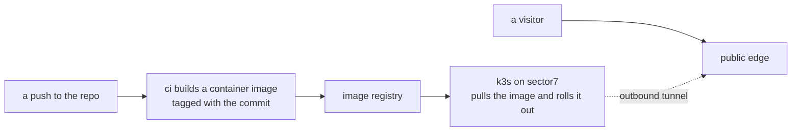

# deployment

how a commit becomes the running site. it is gitops, self-hosted, on k3s: the
cluster is the one on [sector7](hosts/sector7/README.md).

1. **a push builds an image.** a workflow in the app's repo runs on every
   push, builds a container image from the source, and tags it with the full
   commit hash.
2. **the image goes to a registry.** the same workflow pushes it. the registry
   password is a repo secret.
3. **the cluster pulls it and rolls it out.** k3s on sector7 runs the new
   image in place of the old one.
4. **traffic arrives through an outbound tunnel.** the cluster dials out to a
   public edge, and visitors reach the site there. no port on the home network
   is opened for it.

two apps are deployed this way today: the site and one other.

steps 1 and 2 are read from the workflow files in those repos. what runs
inside the cluster, including the piece that notices a new image, is not
written down here yet.
